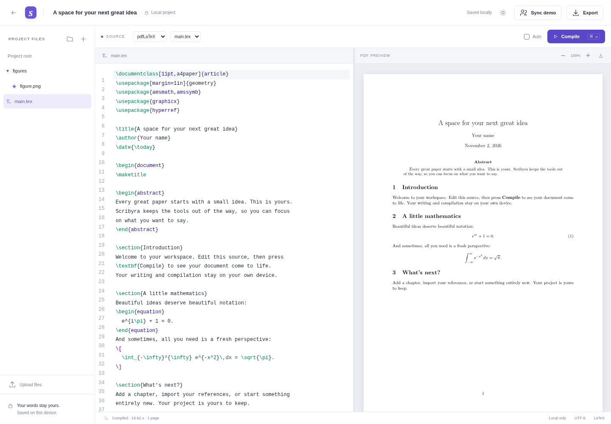

# Scribyra

A local-first, open-source LaTeX workspace built with **Rust + Leptos**, CodeMirror, and a WebAssembly LuaLaTeX compiler. Editing, storage, compilation, and PDF rendering happen on your device. No account is required.

This is a **public beta**, not a production Overleaf replacement. It is tested on Linux in Chromium, Firefox and WebKit, not yet on macOS, Windows or Safari, and collaboration is experimental. It includes a real local editor, offline persistence, LuaLaTeX compilation, ZIP import/export, PDF previews, and an optional loopback collaboration experiment. Anchored comments, proposed source changes, named history and complete project backups work locally. Production sharing/authentication and Git integration remain subsequent milestones.



## Run locally

With Nix (recommended on NixOS):

```sh
nix develop
npm ci
npm run assets
npm run fixtures
npm run build
npm run preview
```

Open **http://127.0.0.1:4173**. Choose **Start with a sample paper**, then **Compile**. The first compile initializes LuaLaTeX with a 43.5 MiB baseline data set plus engine and metadata. Missing packages and fonts download as needed from verified metadata shards; later compiles reuse the worker. `npm run assets` downloads a pinned, SHA-256-verified 522 MB upstream archive, extracts approximately 686 MiB, and uses Rust to generate the smaller baseline and static components. The resulting `dist/` is approximately 310 MiB; the browser fetches the components it needs. Documents never go to a compilation server.

For frontend development:

```sh
npm run wasm
npm run dev
```

Re-run `npm run wasm` after Rust UI changes. Vite handles JavaScript/CSS changes. Offline support is enabled in production builds (`npm run build` / `npm run preview`), not in Vite development mode.

`npm run tex:catalog:check` verifies the retained runtime archive pins and dated
dependency source offline. Builds also verify the pinned LuaHBTeX binary and
prebuilt format; their identities are visible in **More tools** → **TeX environment**.

After building, `npm run measure:runtime` reports generated asset sizes.
`npm run measure:browser -- --runs=3 --output=tmp/runtime-browser.json` measures
actual uncompressed response payloads, sampled Linux browser-process memory,
worker/WASM capacity and cold/warm/offline compilation. It starts its own
loopback server and uses disposable profiles with a public synthetic article.
See the [measurement method and limits](docs/tex-packages.md#browser-transfer-and-memory-measurements-goal-2c3b).
`npm run measure:recovery -- --runs=3 --seconds=12` reproduces interrupted
downloads with persistent and closing HTTP connections, recording slow outcomes.
Use `--protocol=https` or `--protocol=h2` to compare TLS transports (requires OpenSSL),
and `--rate=153600 --seconds=420` for a deliberately slow resumed transfer.

Without Nix: use Rust 1.99.1 with the `wasm32-unknown-unknown` target, Node.js 22.23 or newer, Python 3, a C compiler (for SQLite), `tar`, and `wasm-bindgen-cli` **0.2.129**. The CLI version must match Cargo.lock. All runtime/compiler dependencies are open-source; the application does not need a SaaS account, API key, or license server.

## AI agents and MCP providers

AI agents work with an open project through the tab itself, using their own
browser tools. The editor serves a short recipe at `/agent.md` describing the
experimental `window.scribyra.agent` interface; see the
[project command contract](docs/commands.md) and the
[decision record](docs/reorientation.md).

**More tools** → **MCP providers** connects the open project to compatible HTTP
MCP servers whose address you enter. Source disclosure and tool calls require
explicit actions, and connections and tokens stay in memory until the project
closes; see [provider setup, permissions and limits](docs/mcp-providers.md).

The Rust companion app is discontinued (November 8, 2026). The editor no longer
offers it and never contacts a local companion. Its code remains in
`crates/companion` only so its tests keep running.

## Local diagnostics

Open **Diagnostics** (in the projects sidebar, or **More tools** → **Diagnostics** in a project) to enable a bounded local event timeline and review a safe
JSON support export, including while offline. Collection and export are off by
default. No collector is required; broader instrumentation and Grafana integration
remain in progress. Official Pages builds offer separate, all-off category consent
for Grafana Cloud, a third-party service. Source-tree and self-hosted builds have
no destination or prompt unless configured. See [controls, exact fields and validation](docs/telemetry.md).

## What works

- Project dashboard and search; nested folders with keyboard navigation; file/folder create, rename, move, duplicate, delete and restore; atomic file/folder imports and drag/drop moves/uploads; main-file selection, themes, and resizable source/PDF panes.
- Stable file tabs with per-session cursor/selection restoration and per-file undo. Tabs, font size, indentation, wrapping and auto-compile preferences persist on this device. Project settings control the name, main document and engine.
- Rust project search with Unicode, case/whole-word options, regular expressions, selectable replacement previews and cross-file batch undo/redo. Source outlines navigate literal headings. Search and outline work offline in cancellable workers.
- Reviewed literal LaTeX reference updates when moving/renaming files or folders. Choose individual edits, move without edits, or cancel; stale reviews are rejected. Macro-generated and custom search paths require manual review.
- Image previews with dimensions, download and validated replacement that preserves the project path. PNG/JPEG/PDF figures can be inserted at the remembered source cursor using paths relative to the main document. Empty folders and binary bytes survive source ZIP export/import.
- Anchored comment threads, causal resolution, proposed source changes with explicit authority-checked acceptance and isolated preview compilation. Named history, reviewed restoration, compaction and complete `.scribyra-backup` files preserve discussion and assets offline. See [integration evidence and limits](docs/integration-567.md).
- Experimental direct browser sessions behind an off-by-default Share setting, with a manually configured connection service and trusted full editors. Local browser checks and remaining real-network gates are recorded in the [direct-session design](docs/direct-sessions-design.md).
- Automatic live synchronization between tabs in the same browser profile, with local-only undo, verified assets, resume/polling fallback and visible recovery projects for competing binary versions or deletion. [Local sync scope](docs/local-sync.md); folder and paired-device adapters remain upcoming.
- Local project text and assets stored in IndexedDB with visible save status. Binary assets are checksum-verified and deduplicated across files, projects and durable revisions. Shared Rust tree validation and stable IDs preserve text/undo identity across folder moves. Existing projects migrate with an atomic recovery copy, exportable from the project menu.
- Browser-worker LuaLaTeX, BibTeX, Biber, and multiple passes for cross-references using TeXlyre-BusyTeX 1.4.1 / TeX Live 2026.
- On-demand TeX package downloads with Rust/WASM archive verification and offline caching, multilingual Babel support, BibLaTeX/Biber, and actionable compilation diagnostics. [Downloaded packages](docs/tex-packages.md) use compiler-matched static components and an existing TeX Live mirror without changing project files or ZIP exports.
- A TeX environment dialog locks the compiler/adapters/catalog and supplemental package versions, inspects/removes cached archives, caches a locked set with progress/cancellation, and verifies portable package-bundle export/import. Lock metadata stays with the journaled project; source ZIPs remain source-only. Bundles contain supplemental packages, with the app/compiler assets prepared separately. See [environment locks and package transfer](docs/tex-packages.md).
- Manual compilation and optional 1.8-second debounced automatic compilation. Cancellation terminates the worker; later compilation recreates it. A cumulative 180-second compiler-execution budget stops runaway jobs; component preparation uses separate download/processing limits.
- Source ZIP export/import, PDF download and compilation logs. The PDF reader has selectable text, internal links, page navigation, case/whole-word search, fit-width/fit-page controls and zoom that preserves position. Offscreen canvases are evicted; failed compilation keeps the previous PDF visible. Rust SyncTeX queries connect source lines and PDF locations for LuaLaTeX, including nested Unicode paths; editing invalidates the mapping until the next compilation.
- Resumable verified downloads for compiler assets, metadata and TeX archives. Device cache limits and interrupted-download controls are in **TeX environment**; zero disables caching while online compilation remains available.
- Offline application shell and cached compiler packages after first preparation. Browser storage remains subject to user deletion; persistent-storage requests and source ZIP backups are available.
- Project imports are limited to 64 MiB expanded, 512 files and 1024 total file/folder entries. Recoverable deleted contents also count toward the project byte limit. Traversal, absolute paths, encrypted archives, symlinks, and malformed ZIP metadata are rejected.

**Ctrl/⌘ + Enter** compiles or cancels. **Ctrl/⌘ + F** searches the source. **Ctrl/⌘ + Shift + F** opens project search, **Ctrl/⌘ + Shift + O** opens the outline, and **Alt + W** closes the current file. Focus a file tab and use Left/Right or Home/End to switch files; Delete closes that tab. **Tab** indents. **Alt + Enter** jumps from the source line to the PDF; **Ctrl/⌘ + click** a PDF location jumps back to its source line. The PDF toolbar arrow (or Alt + Enter with the PDF focused) uses selected PDF text or the visible page. Navigation is line-level and depends on the engine’s SyncTeX output. In the PDF preview, Ctrl/⌘ + F opens PDF search; Enter/Shift + Enter move between matches and Escape closes search or clears the PDF selection. Focus the PDF container and use Left/Right or Home/End to navigate pages. Focus the pane divider and use the arrow keys to resize it. Use `/` on the dashboard to focus project search. In the tree, arrow keys navigate/expand/collapse, Home/End jump, F2 renames, and Delete removes a node. Use **Project root** before adding at the top level; otherwise creation/upload uses the selected directory. Drop onto a folder to import or move there, or onto Project root to move to the top level. **Duplicate** creates independent text and file identities. Folder import preserves empty directories when the browser supplies directory handles; the file-input fallback explains that empty folders require ZIP import.

## Optional two-client sync demo

In a second terminal:

```sh
nix develop
cargo run -p scribyra-sync --example plaintext-demo
```

The Axum server listens on `127.0.0.1:8787` and persists Yrs document state and immutable binary assets to `scribyra-sync.sqlite` (override with `SCRIBYRA_SYNC_DB`). It intentionally has **no accounts or authorization**. It accepts browser origins only from the documented local development/preview ports; keep it local.

To share one existing project between two independent browser profiles:

1. The demo is hidden in normal use. In each profile, run `localStorage.setItem('scribyra-plaintext-demo','1')` in the browser console and reload.
1. Open the project in the first profile and choose **Sync demo**. Enter a fresh room name.
2. In the second profile, create a disposable project, delete its starter file, and connect to the same room.
3. Both profiles receive the shared files. Open the same source file and edit concurrently. Live cursors appear as the peers exchange awareness updates.
4. Disconnect one profile, edit, then reconnect to exercise conflict-free merging. Restart the server to verify durable recovery.

Connecting merges documents. Starting two independently seeded projects in the same room intentionally retains both file identities; it is not production project-sharing UX. No persistent synchronization connection is made until you explicitly connect. Browser copies stay locally available after disconnecting.

The demo is a loopback-only Cargo example, excluded from release service images.
`npm run sync` now starts the authenticated opaque service; it does not accept
this demo protocol. See [service installation and operations](docs/service.md).

## Checks

```sh
cargo test -p scribyra-core -p scribyra-sync
npm test
npm run test:sync
npm run test:wrappers
npm run build
npm run test:e2e
```

The Nix shell supplies Playwright's patched browsers. Without Nix, run `npx playwright install --with-deps` first. Browser tests include actual TeX compilation and need `npm run assets` and `npm run fixtures`. Run one browser with `npm run test:e2e -- --project=chromium`. Benchmarks are written under `test-results/`. Native composition acceptance includes Chromium CDP, Gecko TextInputProcessor, and a Linux WPE input-method adapter. The WPE test needs GLib/GObject development headers and `pkg-config` (included by the Nix shell). The Gecko test uses an isolated temporary browser profile and loopback Marionette port 2828; it refuses to run when the port is already occupied and verifies the profile before privileged input. These adapters are test-only and are never included in the static app. See [workspace acceptance](docs/workspace-acceptance.md) for coverage and platform limits.

## Self-hosting

Serve `dist/` on HTTPS (localhost HTTP is allowed for development). It contains the application and compiler assets. Use `application/wasm` for WASM and JavaScript MIME types for `.js` / `.mjs`. Configure no-cache for `index.html` and `sw.js`, and long-lived caching for hashed app assets. Provide disk/storage bandwidth appropriate for the bundled TeX assets. No cross-origin isolation headers or shell execution are required.

The compiler path defaults to `/core/busytex`; set `VITE_TEX_ASSET_BASE` at build time to another **same-origin path** when necessary and serve the generated `core/busytex/` contents there. The build configures the service worker to match. Compiler-matched static components are preferred; packages absent from that collection can download from an existing TeX Live mirror using pinned checksums. See [package downloads and mirror configuration](docs/tex-packages.md). Packages requiring native shell commands or unavailable fonts/tools fail with a log; no server fallback silently uploads source.

For efficient download resume, static hosting should support byte ranges with an accurate `Content-Range`. Cross-origin package mirrors should expose that header through CORS. Servers that only return full responses still work; Scribyra restarts and verifies the complete pinned file.

Portable package bundles include their pinned metadata, allowing import with an empty metadata cache while offline. Sources and compiler assets remain separate.

After compiling successfully, choose **TeX environment → Prepare this project for offline use**. This verifies and saves the compiler, baseline, Biber helpers and supplemental packages, then locks the project environment. Readiness is checked against actual cache contents; browser storage eviction can require preparation again. **Clear compiler cache** and package cache controls do not delete project sources. Upgrades that change the compiler fingerprint require explicitly unlocking and compiling again before creating a new lock.

`npm run assets`, `npm run dev`, and `npm run build` apply the checked-in wrapper fixes automatically. These preserve the original TeX error, stop before running bibliography tools on a failed document, and avoid corrupt accented bibliography names using Biber's safe-character output. Compiler wrapper caching follows the app build while the larger immutable TeX data stays cached across upgrades. The bundled collection still does not contain every TeX Live package.

Keep the same origin when upgrading if you want to preserve browser projects. Back up local source ZIPs independently. For the sync demo, use SQLite's backup API or stop the server before copying its database; do not copy a live database without its WAL state.

## Project structure

- `crates/app`: Leptos UI and typed view state, compiled to WASM.
- `crates/core`: portable project types, tree commands, migration normalization, and path validation.
- `crates/assets`: native Rust baseline/component builder and font metadata index.
- `crates/sync`: optional opaque Rust service, SQLite metadata and blob storage; the plaintext Yrs experiment is a separate loopback-only example.
- `web`: browser adapters for CodeMirror, Yjs, storage, compilation, PDF rendering, and offline caching.
- `fixtures`, `tests`, `scripts`: reproducible documents, automated checks, asset preparation, and benchmark tooling.

See [architecture](docs/architecture.md), the [project command contract](docs/commands.md), [runtime and exchange contracts](docs/exchange.md), [workspace acceptance evidence](docs/workspace-acceptance.md), [feasibility results](docs/feasibility.md), and [SwiftLaTeX evaluation](docs/swiftlatex.md).

Future work is organized in the [product roadmap](docs/roadmap.md), supported by the [static architecture and Rust feasibility study](docs/static-architecture-study.md). These describe proposed milestones, separate from shipped prototype features. Browser capability measurements can be reproduced with `node scripts/capabilities.mjs` in the Nix shell while the preview server is running.

## License and product promise

Copyright (C) 2026 URUNDEAD LABS S.R.L.

This program is free software: you can redistribute it and/or modify it under the terms of the GNU Affero General Public License as published by the Free Software Foundation, version 3 of the License.

This program is distributed in the hope that it will be useful, but WITHOUT ANY WARRANTY; without even the implied warranty of MERCHANTABILITY or FITNESS FOR A PARTICULAR PURPOSE. See the GNU Affero General Public License for more details.

You should have received a copy of the GNU Affero General Public License along with this program. If not, see <https://www.gnu.org/licenses/>.

Scribyra's application code is **AGPL-3.0-only**; see [LICENSE](LICENSE) and [COPYRIGHT](COPYRIGHT). Retain third-party notices and licenses when distributing builds; see [THIRD_PARTY.md](THIRD_PARTY.md). TeX distributions contain components under several licenses.

All product features will remain available in the free self-hosted edition. Paid hosting will provide managed synchronization, storage, backups, and support. There are no feature gates or license checks in this codebase.

## Presentation site and app

The presentation is at **https://scribyra.com/** and the app at **https://app.scribyra.com/**. Neither needs sign-in, and both may be indexed by search engines; `robots.txt` points to a small `sitemap.xml` for scribyra.com. The staging site (https://dev.scribyra.com/, see [delivery](docs/delivery.md)) stays out of search indexes. The older **https://scribyra-aca39a.gitlab.io/** address keeps working. **Open app** leads directly to **https://scribyra-aca39a.gitlab.io/app/**. The default-branch pipeline builds the production Rust/WASM browser release and publishes it with the matching presentation. No installation or local server is needed to use that deployment. The first compile downloads its required pinned TeX assets; warmed/prepared projects can work offline. The release-registration job creates a `web-<pipeline number>` GitLab release with an app link; `/app/release.json` identifies the exact commit and pipeline. Unfinished features remain unfinished regardless of a release build.

The `site/` directory remains the presentation source. For a local deployment preview, run `npm run build:pages`, then `python3 -m http.server 4175 --directory .pages`. The app's assets and service worker stay under `/app/`, leaving the presentation outside its offline cache. CI pins Node/Rust/wasm-bindgen, verifies compiler archives, reuses extracted compiler/tool/dependency caches and discards the large downloaded archive. The assembled release is about 320 MiB (approximately 249 MiB ZIP), below GitLab.com's 1-GiB artifact limit. Build artifacts are maintainer-only and expire after one day; the active Pages deployment does not expire. Opening the app uses the latest successfully deployed production build. The first GitLab.com pipeline/deployment for this change still needs verification; the assembled release passes local online/offline compile checks.

The GitLab repository and its Pages site are public. Staging's `noindex`/`robots.txt` directives are indexing preferences, not access control. The page distinguishes working prototype features from the roadmap.
