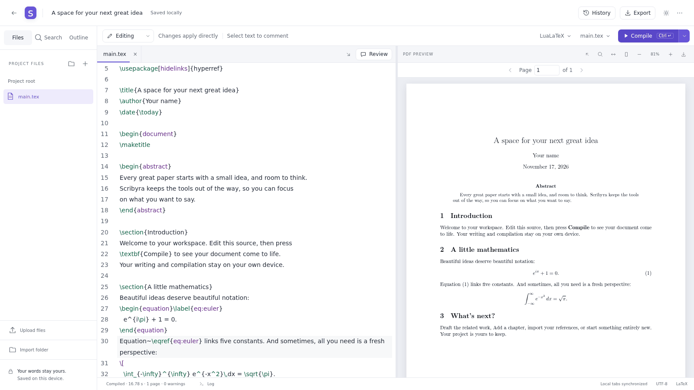
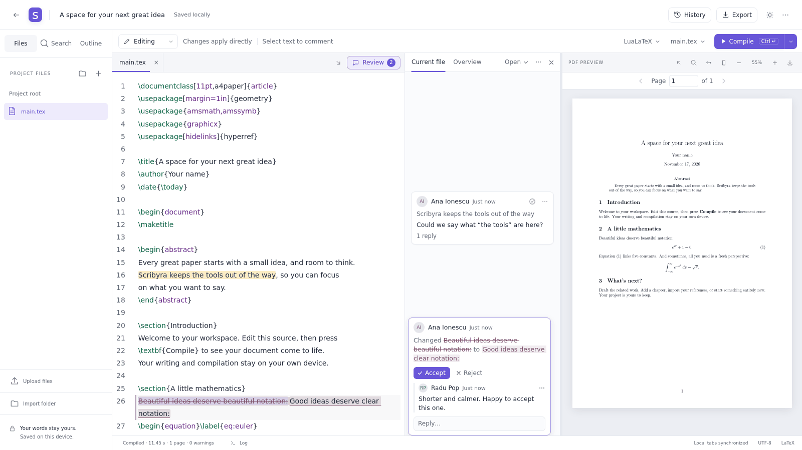
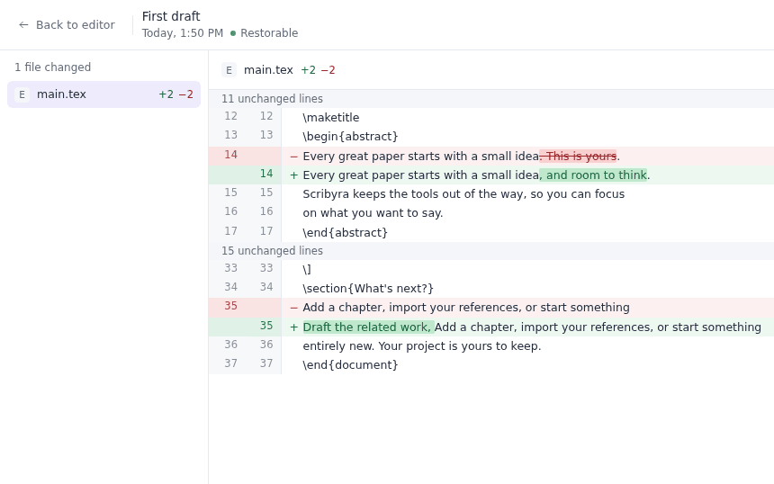
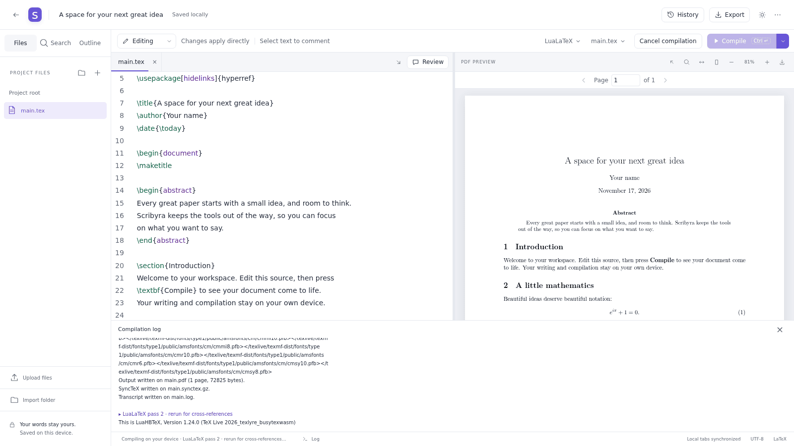

<p align="center">
  <a href="https://scribyra.com/">
    <picture>
      <source media="(prefers-color-scheme: dark)" srcset="assets/brand/logo-dark.svg">
      
    </picture>
  </a>
</p>

<h3 align="center">Room to think. A quiet, local-first LaTeX editor in your browser.</h3>

<p align="center">
  Write, compile and review LaTeX without an account. Your projects stay on your device,<br>
  and LuaLaTeX runs right in the tab, even offline.
</p>

<p align="center">
  
  <a href="LICENSE"></a>
  <a href="https://github.com/Scribyra/scribyra/releases"></a>
  <a href="https://github.com/Scribyra/scribyra/actions/workflows/production.yml"></a>
  <a href="https://github.com/Scribyra/scribyra/actions/workflows/checks.yml"></a>
</p>

<p align="center">
  <a href="https://app.scribyra.com/"></a>
  &nbsp;
  <a href="https://scribyra.com/"></a>
</p>

<br>

<p align="center">
  <a href="https://app.scribyra.com/">
    <picture>
      <source media="(prefers-color-scheme: dark)" srcset="docs/screenshots/editor-dark.png">
      
    </picture>
  </a>
  <br>
  <sub>The real workspace with the sample paper. Editing, compiling and the PDF preview all happen in your browser.</sub>
</p>

## Why Scribyra

<table>
  <tr>
    <td width="33%" valign="top">
      <b>🔒 Yours, on your device</b><br>
      Projects live in your browser. No account, no sign-in, and compiling never uploads your document.
    </td>
    <td width="33%" valign="top">
      <b>⚡ Real LuaLaTeX, in the tab</b><br>
      TeX Live 2026 compiled to WebAssembly. One ~79&nbsp;MB download on first use, then it works offline.
    </td>
    <td width="33%" valign="top">
      <b>💬 Comments and suggestions</b><br>
      Comments anchored to your text, suggested changes you accept or reject, and a discussion on each.
    </td>
  </tr>
  <tr>
    <td width="33%" valign="top">
      <b>🕰️ History you can go back to</b><br>
      Named versions, line-by-line comparisons, restore, complete backups and plain ZIP export.
    </td>
    <td width="33%" valign="top">
      <b>📜 See TeX at work</b><br>
      A live compile log streams each pass, its output and warnings while the document builds.
    </td>
    <td width="33%" valign="top">
      <b>🤖 Bring your AI agent</b><br>
      <em>Experimental.</em> An agent with a browser tool can read, edit and compile in your open tab.
    </td>
  </tr>
</table>

Free and open source under the AGPL. Every feature stays available in the free self-hosted edition: no feature gates, no license checks.

## What works

<p align="center">
  <picture>
    <source media="(prefers-color-scheme: dark)" srcset="docs/screenshots/review-dark.png">
    
  </picture>
  <br>
  <sub><b>Review together.</b> Comment on a selection, suggest changes that stay out of your source until accepted, and discuss each one.</sub>
</p>

<table>
  <tr>
    <td width="50%" valign="top">
      <picture>
        <source media="(prefers-color-scheme: dark)" srcset="docs/screenshots/history-dark.png">
        
      </picture>
      <p align="center"><sub><b>Go back in time.</b> Compare named versions, then restore in place or as a copy.</sub></p>
    </td>
    <td width="50%" valign="top">
      <picture>
        <source media="(prefers-color-scheme: dark)" srcset="docs/screenshots/compile-log-dark.png">
        
      </picture>
      <p align="center"><sub><b>Watch it compile.</b> Each pass, its output and warnings stream in live.</sub></p>
    </td>
  </tr>
</table>

Also: folders, file tabs, project search and replace, an outline, image previews, BibTeX and Biber, on-demand TeX packages, pinned TeX environments, live sync between tabs, PDF search and keyboard navigation. The [complete list, with keyboard shortcuts](docs/features.md), says exactly what works and where the limits are.

## Try it

No install. Open **[app.scribyra.com](https://app.scribyra.com/)**, choose **Start with a sample paper**, then press **Compile** (<kbd>Ctrl</kbd>/<kbd>⌘</kbd> + <kbd>Enter</kbd>).

- The first compile downloads LaTeX once (about 79&nbsp;MB). After that the app reopens and compiles offline.
- Already have a project? **Import ZIP** brings it in; **Export** takes it out as ordinary LaTeX files.
- Your browser's storage is not a backup. Export a ZIP or a complete backup now and then.

> [!NOTE]
> Scribyra is a **public beta**. It is tested on Linux in Chromium, Firefox and WebKit, not yet on macOS, Windows or Safari. Direct sessions between browsers are experimental and off by default.

## Use it with an AI agent

An AI agent that has its own browser tool (for example Playwright MCP or Chrome DevTools MCP) can work in the project you have open: read files, apply edits, compile and read diagnostics. Nothing of ours to install, and it runs under your control, not on our servers.

Point your agent at the open tab and its recipe, **[app.scribyra.com/agent.md](https://app.scribyra.com/agent.md)**, which documents the experimental `window.scribyra.agent` interface. The [project command contract](docs/commands.md) has the details. You can also connect HTTP MCP providers from **More tools → MCP providers** ([setup and limits](docs/mcp-providers.md)).

## Run it yourself

Scribyra is a static site: build it once and serve `dist/` from any HTTPS host.

<details>
<summary><b>Quick start with Nix</b></summary>

```sh
nix develop
npm ci
npm run assets     # pinned, verified TeX Live archive (downloads ~522 MB once)
npm run fixtures
npm run build
npm run preview    # http://127.0.0.1:4173
```

Then choose **Start with a sample paper** and **Compile**. For the Vite dev server, run `npm run wasm && npm run dev`.

</details>

Everything else, including setup without Nix, tests, measurements, self-hosting and the release pipeline, is in **[docs/development.md](docs/development.md)**. The [architecture overview](docs/architecture.md) explains how the pieces fit: Rust and Leptos compiled to WebAssembly for the UI and core, CodeMirror for editing, Yjs for local sync, and BusyTeX for LuaLaTeX.

## Roadmap

- ✅ **Available today:** the everyday workspace, TeX downloaded as you need it, comments, reviews and history, and bibliographies imported from `.bib` files or linked to a Zotero library.
- 🧪 **Experimental:** an AI working in your tab, and direct sessions on a shared network (off by default).
- 🗺️ **Planned:** remote and local Git, plugins, remote backup, sync and collaboration, end-to-end encryption, and managed hosting.

The [full roadmap](docs/roadmap.md) has the milestones, their state and the evidence behind them.

## Contributing

Bug reports, ideas and pull requests are welcome. [CONTRIBUTING.md](CONTRIBUTING.md) explains how to file a useful issue and how changes flow from a `feature/*` branch into `dev`. For security issues, please follow [SECURITY.md](SECURITY.md) instead of opening an issue.

## Support and contact

Found a problem or have a question? [Open an issue](https://github.com/Scribyra/scribyra/issues/new/choose) or email **[contact@scribyra.com](mailto:contact@scribyra.com)**. Nothing is sent automatically, and attaching a project is entirely up to you.

## License

Copyright © 2026 URUNDEAD LABS S.R.L.

Scribyra is free software, licensed under the **GNU Affero General Public License, version 3 only** ([AGPL-3.0-only](LICENSE)); see also [COPYRIGHT](COPYRIGHT). It comes with no warranty. Third-party components keep their own licenses; keep their notices when distributing builds ([THIRD_PARTY.md](THIRD_PARTY.md)). TeX distributions contain components under several licenses.

<p align="center">
  <br>
  <a href="https://scribyra.com/"></a>
  <br>
  <sub><i>A little more possibility.</i></sub>
</p>
