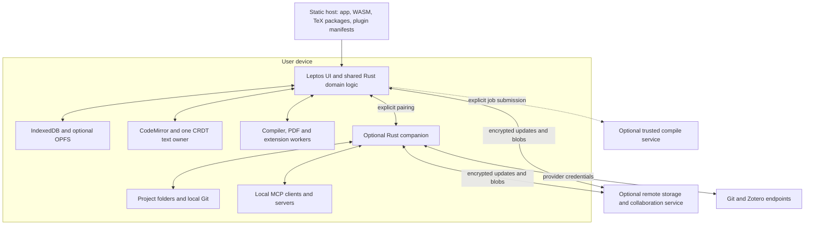

# Scribyra static architecture and Rust feasibility study

November 2, 2026. The recommended design keeps the browser application, presentation site, TeX repository, and extension registry statically deployable. An optional Rust companion supplies operating-system access. Optional remote services supply durable shared storage, collaboration transport, and managed-hosting operations. Server compilation remains a separate, explicitly selected backend.

The application can retain its local editing, compilation, comments, reviews, and history without a Scribyra application server. Remote collaboration and remote backup necessarily involve another running system, but they do not require moving those features' computation to that system. A static frontend can remain the same frontend in every deployment.

The [product roadmap](roadmap.md) preserves the requested feature order. This study distinguishes verified prototype behavior, browser constraints, and proposed implementation choices. It does not treat a browser API's existence as evidence that a complete feature has shipped.

## What static means

**Static delivery** means serving prebuilt HTML, CSS, JavaScript, WASM, manifests, and files over HTTPS, without running application code for each request. Workers can execute substantial local computation, and downloads can happen on demand. Downloading another TeX package does not make the origin a dynamic application server.

**Offline operation** additionally requires the relevant app, engine, package, and project bytes to be present locally. A static app is not automatically offline-ready. A static app connecting to Zotero or a remote Git server also has an external dynamic dependency, even when Scribyra operates no backend.

**A native companion** is a downloadable binary with a local runtime. Its distribution is static; its directory watchers, MCP endpoints, and sync processes are not. It can remove the need for a centrally hosted service without making those operations browser-only.

## Feature feasibility

| Feature | What stays in the static app | Additional runtime needed |
| --- | --- | --- |
| Folder tree, source editing, images, search, PDF preview | All UI, project operations, asset handling, local persistence | None for browser projects; permission/companion for OS folders |
| Local TeX compilation | Engines, fonts/packages, workers, logs, PDF output | None for supported WASM workloads; native/remote runner for unsupported tools |
| Download TeX components as needed | Resolver, indexes, archives, verification, offline cache | A static file host suffices; no runtime package server required by the proposed design |
| Expose Scribyra through MCP | Tool schema, project commands, consent and scope UI | Companion or remote endpoint for standard external MCP clients |
| Connect to MCP servers | Client UI and browser-compatible HTTP transport | The selected server; companion for stdio and incompatible browser access |
| Same-browser local synchronization | CRDT updates and local channel messages | None, within the same origin/profile/storage partition |
| Folder synchronization | Reconciliation UI and import/export logic | Browser support while active, or companion for reliable background/portable access |
| LAN collaboration | Editor, merge logic, presence UI | Local hub/companion; alternatively signaling and possibly a relay for WebRTC |
| Comments and reviews | Threads, anchors, suggestions, diff/accept/reject, preview | Transport for exchanging them; none for local use or manual review bundles |
| History | Checkpoints, diffs, restore, retention UI | External storage only when a separate backup is wanted |
| Git | Repository UI and potentially an in-browser object store | A Git remote for network operations; companion or proxy if browser transport is incompatible |
| Plugins and Zotero | Plugin registry/artifacts, execution host, citation UI, file imports | Provider API or local Zotero/companion for live integration |
| Remote collaboration and backup | Merge, validation, encryption, UI | Authenticated durable storage/relay service |
| End-to-end encryption | Encryption/decryption and client-side key management | Remote storage carries ciphertext; recovery/pairing can involve the service |
| Presentation website | Build-time HTML, assets, docs, demos, downloads | None; managed-account/billing operations have separate endpoints |

There is no useful evidence-backed percentage for “how much is static.” The stronger and testable claim is that **none of the ordinary writing workflow needs request-time server rendering or server-side document processing**. The service boundary is storage, communication, and optional execution/integration—not which editing features a user is allowed to have.

## Evidence from this repository

The [existing feasibility results](feasibility.md) verify local pdfLaTeX, XeLaTeX, LuaLaTeX, BibTeX, Biber, offline restart, and a simple 100-page project in Chromium, Firefox, and WebKit. The current app is already statically built. It uses Rust/Leptos for UI, JavaScript browser adapters, Yjs in the editor, and a separate Rust/Yrs plaintext sync experiment.

The real-paper follow-up added Romanian support, class-aware Biber selection, clearer errors, and a Biber encoding workaround. A corrected copy of the private paper compiled to 36 pages. This demonstrates useful compatibility, not universal Overleaf equivalence; the user's paper is not part of the public test corpus.

The original prototype loaded a roughly 326 MiB TeX collection, plus the combined engine and optional tools. Goal 2b replaces that preload with 43.53 MiB of LuaLaTeX data and fetches omitted files as immutable static components. It also verifies full compiler/Biber/package preparation for offline use. See [current sizes and boundaries](tex-packages.md#smaller-lualatex-baseline-and-static-components-goal-2b). The app's Rust UI is comparatively small; reducing the TeX payload has more effect on first use than rewriting small JavaScript adapters.

### Browser capability probe

Measured in disposable headless Linux profiles at the local preview origin. The raw report is [static-capabilities.json](measurements/static-capabilities.json); the reproducible probe is [scripts/capabilities.mjs](../scripts/capabilities.mjs).

| Check | Chromium 156 | Firefox 157 | WebKit 27.2 |
| --- | --- | --- | --- |
| WASM, service worker, IndexedDB APIs present | Yes | Yes | Yes |
| OPFS API present | Yes | Yes | Yes |
| Actual OPFS file write/read/delete | Passed | Passed | Failed with `UnknownError` in this environment |
| Directory picker API present | Yes | No | No |
| File system observer API present | Yes | No | No |
| BroadcastChannel message exchange | Passed | Passed | Passed |
| AES-GCM encrypt/decrypt and tamper rejection | Passed | Passed | Passed |
| WebRTC API present | Yes | Yes | Yes |
| SharedArrayBuffer under current hosting headers | No | No | No |

The probe does not exercise OS permission prompts, actual folder watching, WebRTC network traversal, mobile devices, long-term durability, or a complete encryption protocol. The WebKit OPFS failure is a release-gate issue to investigate on real Safari/macOS and supported desktop environments; it is not evidence that Safari universally lacks OPFS. Retain the already-tested IndexedDB path.

Reproduce while `npm run preview` is running:

```sh
nix develop
node scripts/capabilities.mjs
```

OPFS is origin-private storage, not the user's visible project folder. Browser storage remains quota-managed and may be deleted; persistent-storage requests do not replace independent backups. Direct directory pickers have narrower browser support. These distinctions are documented by [MDN on OPFS](https://developer.mozilla.org/en-US/docs/Web/API/File_System_API/Origin_private_file_system), [storage eviction](https://developer.mozilla.org/en-US/docs/Web/API/Storage_API/Storage_quotas_and_eviction_criteria), and [directory access](https://developer.mozilla.org/en-US/docs/Web/API/Window/showDirectoryPicker).

## Proposed component boundaries



The same project commands run from the UI, MCP, plugins, and companion. Platform adapters provide persistence, transport, credentials, filesystem access, and worker execution. A dependency on an unavailable adapter should yield a useful capability explanation rather than disable the whole application.

Keep large text editing on a direct CodeMirror/CRDT path. Rust can own command validation, project structure, package resolution, and review/history policy without requiring a full document serialization across the WASM boundary on each keystroke.

## TeX packages can be delivered entirely as static files

The compiler's need for another file is a lookup problem. At repository-build time, transform a pinned TeX distribution into engine manifests, package/dependency indexes, a filename/search-priority index, and immutable package archives. At runtime the browser resolves the lookup, downloads static bytes, verifies them, and mounts them in the compiler's virtual filesystem.

An initial design should include:

1. A small baseline for each supported engine and compatible prebuilt format.
2. Versioned, sharded manifests so every visitor need not download the whole catalog.
3. Package identity, dependency closure, license/source references, archive size, and digest.
4. Search semantics for filenames, formats, case aliases, and duplicate basenames; a filename alone is not always a unique package locator.
5. A project environment lock including engine build, format build, TeX distribution revision, selected package digests, and user-supplied overrides.
6. Download/install transactions and a bounded retry loop that distinguishes a missing dependency from a document error or unsupported executable.
7. Cache limits and an explicit way to prepare or export the locked set for offline use.

BusyTeX already documents a missing-file endpoint contract using format IDs and filenames. Its supplied server is a dynamic implementation; **replacing that lookup with static indexes/objects is a proposed adapter change**, not a capability already delivered by Scribyra. The integration must handle the compiler worker's synchronous lookup behavior: either provide preloaded virtual files with bounded compile retries, or implement a tested static lookup bridge. Do not assume an asynchronous JavaScript fetch can transparently replace a synchronous compiler filesystem read. [Upstream endpoint contract](https://raw.githubusercontent.com/TeXlyre/texlyre-busytex-build/main/texlive-server/README.md)

Keep missing-file responses distinct from the app's HTML fallback. Reject corrupt content, cancel stalled downloads, and invalidate negative results by repository version. Do not mix arbitrary current CTAN packages with an older engine/format and call the result reproducible.

Full offline mirrors are optional artifacts for disconnected users and institutions. Hosting a large static catalog still consumes disk and bandwidth; moving it out of a runtime server does not make distribution cost-free. Native shell tools, unrestricted shell escape, external Python/R programs, and arbitrary system fonts remain compatibility boundaries. Prefer a user-controlled native compiler backend for those cases before adding remote compilation.

November 3 local-sync update: [same-profile tab synchronization](local-sync.md) is implemented with committed IndexedDB heads, metadata-only broadcasts and resume polling. Browser storage APIs coordinate local writers; the forthcoming folder/LAN adapters retain their additional native/runtime requirements.

## MCP and the optional companion

November 3 implementation update: both MCP directions now have verified deliveries. The [paired Rust server](exchange.md#optional-rust-companion-and-mcp-server) exposes the active browser command host; the [provider client](mcp-providers.md) uses direct HTTP from the static app and configured stdio through the Rust companion. Manual bearer authentication, CORS and native process permissions remain explicit boundaries.

The current MCP standard defines stdio subprocess communication and Streamable HTTP. A static page can implement client behavior and expose internal tools over a bridge, but it cannot supply a normal always-available stdio/HTTP server endpoint to arbitrary external clients. Use a companion for that endpoint; use a hosted MCP gateway only when remote access is actually desired. Pin protocol compatibility during implementation: the current published revision inspected here is `2026-07-28`, whose HTTP behavior differs from older examples. [MCP transports](https://modelcontextprotocol.io/specification/2026-07-28/basic/transports), [versioning](https://modelcontextprotocol.io/docs/2026-07-28/learn/versioning)

The official Rust SDK is a good candidate for the native endpoint. Its documented implementation uses Tokio and supports both server and client roles. Validate the selected crate release and transports against target clients; browser-WASM compatibility is a separate build spike, not implied by “Rust SDK.” [RMCP source and documentation](https://github.com/modelcontextprotocol/rust-sdk)

Initially the companion forwards authorized commands to a connected browser project. Later it can own a synchronized local replica, enabling file/Git/MCP operations while the browser is closed. It cannot read the browser's IndexedDB just because both processes run on the same machine.

Pair explicitly, restrict project scope, bind local HTTP endpoints to loopback, validate origins, and reject stale writes using revision preconditions. Keep read-only access useful. The MCP specification requires origin validation for HTTP servers and recommends loopback binding locally. [MCP endpoint security](https://modelcontextprotocol.io/specification/2026-07-28/basic/transports/streamable-http)

Browser-to-localhost communication must also handle local-network permission rules, CORS, and denied requests. Offer a companion-served localhost UI or an optional packaged Tauri UI if a public-origin-to-localhost bridge is unreliable. A Tauri wrapper can reuse the frontend and constrain native commands through capabilities; it is an optional packaging layer, not a prerequisite for the web edition. [Local network access](https://developer.mozilla.org/en-US/docs/Web/Security/Defenses/Local_network_access), [Tauri capabilities](https://tauri.app/security/capabilities/)

## Local synchronization has several meanings

**Tabs in one browser profile:** BroadcastChannel can exchange updates among same-origin contexts in the same storage partition. Use it with coordinated persistence and distinct active CRDT client IDs. It does not connect independent browser profiles or computers. [BroadcastChannel boundaries](https://developer.mozilla.org/en-US/docs/Web/API/Broadcast_Channel_API)

**A visible local folder:** use a granted directory handle where supported; otherwise use the companion. The companion watches files, writes atomically, records the last synchronized revision, and converts external changes into document operations. File watcher notifications are hints: reconcile actual contents after sleep or missed events. Protect against feedback loops and preserve both sides of a binary conflict.

**Background activity:** an installed PWA is not a permanent daemon. A service worker's lifetime is controlled by the browser, so continuous folder watching and an always-ready local endpoint belong in the companion. [Service worker lifetime](https://www.w3.org/TR/service-workers/#service-worker-lifetime)

**Other devices on the LAN:** a paired local service is the most direct first implementation. Serve the UI from a secure origin or use native packaging; ordinary HTTP on a LAN address does not receive localhost's secure-context exception. File synchronization software may carry exported files/backups, but should not copy a live browser database or competing replicas' database files.

**Peer-to-peer sessions:** WebRTC can carry document updates, but peers still need to exchange connection information. Manual exchange is possible for a proof of concept; convenient discovery usually uses signaling, and some networks require TURN relaying. This can avoid server-side document storage without guaranteeing a server-free product. Favor the existing relay architecture first and add peer sessions for a measured use case. [Signaling](https://developer.mozilla.org/en-US/docs/Web/API/WebRTC_API/Signaling_and_video_calling), [TURN](https://webrtc.org/getting-started/turn-server)

## Comments reviews and history belong on the client

These features manipulate document state and can operate locally. A service is needed to exchange them automatically between devices, not to implement the thread view, suggestion engine, diff, or restore operation.

Use stable file IDs and CRDT-relative text anchors with quoted context as a fallback. File moves preserve identity; deleted or incompatible selections become detached instead of being silently attached to unrelated text. Local display names are not authenticated authorship; bind attribution to verified devices/memberships when remote access arrives.

Represent suggestions separately from accepted source. Each proposal references its base revision and intended range/content. Acceptance validates that base, applies an attributed transaction, and records the decision. A preview build can apply proposals to an isolated snapshot without modifying the accepted project. Serialize these decisions so two reviewers cannot silently accept contradictory replacements.

The current IndexedDB implementation stores the latest encoded Yjs state. That is persistence, not a user-facing history system. Add an append journal, periodic materialized checkpoints, asset references, revision metadata, and retention rules. A state vector alone does not contain old document content. CRDT garbage collection can make old snapshot reconstruction impossible unless required content is retained. Yrs exposes relative-position and snapshot functionality, but Scribyra must supply its persistence and retention policy. [Pinned Yrs documentation](https://docs.rs/yrs/0.25.0/yrs/)

Keep user history separate from the live merge mechanism. Restore into a copy by default; restoring into the live project applies a new change. Replaying an old update does not reverse newer CRDT changes. Retain referenced binary blobs until all retained checkpoints and pending operations release them.

The proposed data layout separates project structure/text metadata, immutable binary blobs, comments/proposals, and retained checkpoints. The full backup format includes these relationships and schema versions; ordinary source ZIPs remain conventional LaTeX projects. Browser-local history needs a separately recoverable backup to survive loss of the browser profile.

## Git without a mandatory Scribyra server

There are three separate deliverables:

| Mode | Feasibility | Recommended approach |
| --- | --- | --- |
| Git repository inside browser storage | Can be static and offline | Start with an existing browser-capable implementation in a worker if this mode is needed. |
| Git in a visible filesystem checkout | Best supported by the companion | Rust coordination with system Git initially; evaluate Rust Git crates for specific operations. |
| Push/pull to a remote | Requires a Git server, but not necessarily a Scribyra server | Companion for ordinary HTTPS/SSH; browser HTTP where the host allows it; optional restricted CORS proxy otherwise. |

`isomorphic-git` documents browser-worker usage and accepts pluggable filesystem/HTTP clients plus a CORS proxy for clone. A browser cannot bypass another origin's CORS policy, regardless of whether the client is JavaScript or Rust/WASM. A proxy or native transport solves that boundary; a language rewrite does not. [Browser Git worker](https://isomorphic-git.org/docs/en/webworker), [clone options](https://isomorphic-git.org/docs/en/clone), [CORS](https://developer.mozilla.org/en-US/docs/Web/HTTP/Guides/CORS)

Choose a self-hostable proxy only if the browser-only remote workflow is valuable enough to justify another service. Treat it as a credential-sensitive transport, with destination restrictions and no open-proxy behavior. The companion avoids needing that Scribyra-hosted proxy. Use scoped provider credentials; do not embed secrets in static assets. For offline repository transfer, standard Git bundles are an option through the companion; implementing bundle support in a browser library is a separate compatibility check. [Git bundle format and commands](https://git-scm.com/docs/git-bundle)

Git exports a coherent accepted project revision. It should not commit each keystroke, become the real-time merge protocol, or automatically publish private comments/device state. Branch checkout and merges need staged state before entering an active collaborative document. A plaintext Git remote is outside an encrypted-sync confidentiality boundary; encrypted Git blobs would sacrifice ordinary source browsing and diffs.

## Application plugins and Zotero

A registry can be static JSON with immutable downloadable modules, manifest versions, checksums/signatures, permissions, and compatibility ranges. A hosted marketplace, accounts, ratings, and automatic publishing pipelines are additional products, not requirements for installing extensions.

Design a small capability API for project reads, proposed patches, citation sources, panels, import/export, diagnostics, and controlled network requests. Prefer a Rust/WASM guest with explicitly supplied host functions. WASM's isolation depends on the APIs the host supplies; it does not make a granted filesystem or network capability harmless. Arbitrary JavaScript in a same-origin worker can have substantial origin privileges, so a worker alone is not the plugin permission boundary. Use declarative panels or separately sandboxed UI and enforce limits/cancellation. [WebAssembly security model](https://webassembly.org/docs/security/)

Zotero integration should begin with interoperable files. Better BibTeX can automatically update a `.bib` export; the companion can watch that file and offer a bibliography update. This yields an offline-capable path before account integration. [Better BibTeX automatic export](https://retorque.re/zotero-better-bibtex/exporting/auto/)

Then add collection/item selection and refresh using Zotero's Web API, subject to authentication and browser access for the specific endpoint. The local Zotero API exposes the user's database on localhost when enabled; use the companion as the portable bridge. Do not assume local object versions equal online versions or that metadata and attachment endpoints have identical access behavior. Preserve citation keys and protect manual edits with a merge/diff workflow. [Zotero Web API](https://www.zotero.org/support/dev/web_api/v3/basics), [local API](https://www.zotero.org/support/dev/web_api/v3/local_api)

An authorized Zotero/MCP/plugin integration may read decrypted content. End-to-end encryption of remote storage does not remove that access once the user grants it. Keep network access and secrets brokered by the host rather than automatically exposing every project's credentials to each extension.

## Remote sync and encryption change the server design

The present `crates/sync` experiment decodes Yjs updates with Yrs and stores merged plaintext state. It cannot do that to end-to-end encrypted documents without acquiring their keys. The target service therefore has a different responsibility: store and relay authenticated opaque updates/blobs, maintain access and delivery metadata, and acknowledge durable receipt. Clients decrypt, validate, and merge.

Recommended responsibilities:

| Client or companion | Remote service |
| --- | --- |
| Own document keys and verify device/member identity | Authenticate connections and authorize object/room access |
| Encrypt text updates, comments, proposals, attachments, and retained history | Store opaque objects and relay update envelopes |
| Validate signed operations and role permissions after decryption | Enforce transport quotas, envelope limits, and retention contracts |
| Merge CRDT updates and produce authenticated checkpoints | Supply cursors, catch-up ranges, and durable acknowledgements |
| Recover keys and verify invitation membership | Revoke future transport access without claiming to erase old copies |
| Search and compile locally | Optionally run a separately trusted compile job |

Design keys, membership epochs, authenticated encryption, nonce management, replay detection, rollback checks, device loss, and recovery as one protocol. Reuse established cryptographic implementations and obtain review; the AES-GCM probe only proves a browser primitive works. It is not a proof of a secure collaboration protocol. [Browser cryptographic API](https://developer.mozilla.org/en-US/docs/Web/API/SubtleCrypto)

For sharing, an authorized client must authenticate recipient keys rather than trust any public key returned by the relay. Membership and roles must be bound to signed operations/envelopes. A comment-only member must not gain accepted-source write authority by constructing a raw CRDT update. Use independently authorized streams or validate operations on authorized clients; a ciphertext relay cannot inspect their semantics.

Encrypt the project manifest as well as document contents when filenames/titles are meant to be private. Use opaque or project-keyed remote identifiers rather than globally visible plaintext content hashes. The service can still observe traffic timing, object sizes, accounts, and some sharing metadata. Document those limits.

Compaction requires authenticated checkpoints and a protocol for stale devices to reset/catch up without resurrecting deleted state. Snapshot completeness must include assets and membership state. Keep restorable user history separate from transport-log retention. Do not delete opaque updates solely because an untrusted client claims everyone has them.

Revocation removes future access and rotates future keys; it cannot retract plaintext or old keys already obtained by another participant. Account-password reset and document-key recovery are different operations. Recovery should include another trusted device and an explicit recovery secret; provider-side password recovery must not quietly become document decryption authority.

The browser application itself remains trusted code. A malicious or compromised host serving new JavaScript could steal keys while a project is unlocked. Self-hosting a reviewed build or using a signed, pinned native distribution narrows that exposure. A signature checked only by code supplied by the same compromised host does not establish an independent trust root.

A conventional remote compiler receives plaintext while processing a job, even if the stored project is encrypted. Label that mode as trusted remote execution and obtain an explicit project/job choice. A native local compiler or user-controlled private compiler is preferable when confidentiality matters. Do not imply that ordinary server compilation operates on encrypted TeX.

## Where Rust improves the product

The objective should be **shared Rust application logic with narrow platform adapters**, not eliminating every non-Rust byte. The current UI is Rust, but project commands, persistence coordination, and compiler orchestration are largely JavaScript. Those are good migration seams because the companion and server will need compatible behavior.

| Area | Decision | Benefit and condition |
| --- | --- | --- |
| Project schema, paths, folders, migration, commands | Move to shared Rust first | One validation and transaction contract for UI, MCP, companion, and plugins. |
| Package index builder, resolver, locks, archive verification | Rust first | Share deterministic resolution between native tooling and WASM; benchmark download/parse/memory costs. |
| Review, history, snapshot manifests, source diffs | Rust domain logic | Share semantics; retain browser editor adapters for anchors/decorations. |
| Native companion, MCP, folder reconciliation | Rust first | Direct fit for filesystem/process access and existing Rust workspace. |
| Optional remote service and protocol envelopes | Rust first | Reuse Axum/Tokio and common types; redesign ciphertext storage separately from the demo. |
| Crypto orchestration | Rust types/protocol logic with reviewed primitives | Use WebCrypto or reviewed portable crates behind adapters; never invent cryptographic algorithms. |
| CRDT text engine | Keep Yjs initially; evaluate Yrs/WASM | Migration requires wire/anchor/undo correctness, Unicode/UTF-16 compatibility, and end-to-end performance gains. |
| Browser editor | Keep CodeMirror | IME, selection, accessibility, undo integration, and extensions make a rewrite a separate long project. |
| PDF rendering | Keep PDF.js | Broad PDF compatibility and text/accessibility behavior outweigh language uniformity. |
| TeX, fonts, bibliography engines | Keep existing engines | Wrap and improve delivery. Reimplementing TeX would jeopardize compatibility and dominate the roadmap. |
| Git | Existing browser implementation or native Git; evaluate `gix` incrementally | Rust Git libraries are candidates, not proof of a complete browser transport/credential/filesystem stack. |
| Tiny browser lifecycle glue | Retain JS where it is simplest | Service workers, DOM events, and adapter entry points need little code; Rust must justify extra bridging. |

Yrs is already a compatible Rust implementation of Yjs and is used by this repository. A Yrs/WASM client spike is therefore more plausible than inventing a new CRDT. However, the current CodeMirror integration expects Yjs objects, so adopting Yrs means replacing that binding—not merely changing an import. Pin supported versions and replay persisted update fixtures during migration. [Yrs](https://docs.rs/yrs/0.25.0/yrs/)

`gitoxide` provides Rust Git components worth evaluating for the companion. Select operations against a compatibility corpus, keeping system Git as a pragmatic fallback; do not claim the whole crate graph works in a browser without testing it. [gitoxide project](https://github.com/GitoxideLabs/gitoxide)

Before replacing a mature library, require a demonstrated limitation, a bounded replacement scope, interoperability tests, and a measured improvement in a user-relevant metric such as typing latency, peak memory, transferred bytes, or recovery behavior. Rust's value here is consistency and reuse as much as execution speed. A WASM port that duplicates text state or adds per-keystroke serialization can make performance worse.

Suggested crate boundaries are `core` for schema/commands, `packages` for repository resolution, `history` for revision policy, `protocol` for envelopes, `companion`/`mcp` for native integration, and a redesigned remote service. Create crates as those responsibilities become real; avoid a large empty framework before the first tree/asset release.

## Deployment products and costs

| Deployment | What the user runs | What it offers |
| --- | --- | --- |
| Static web edition | Any suitable HTTPS static host; localhost for development | Local workspace, browser compilation, local comments/reviews/history, downloadable packages/plugins |
| Offline edition | Cached/pinned static assets or a local package mirror | The same local features for prepared project environments |
| Companion edition | Optional signed Rust binary; optionally a Tauri shell | OS folders, native Git/MCP, background sync, optional native compilation |
| Self-hosted collaboration | Static web edition plus Rust service/database/blob storage | Shared durable storage, invites, presence, sync, encrypted backup after its release gate |
| Managed hosting | The same application/service plus operated infrastructure | Managed capacity, upgrades, backups, uptime/support, account/billing operations |

Serve correct WASM/JavaScript MIME types, actual missing-file responses, and appropriate cache headers. Preserve the app origin across upgrades; browser storage is origin-bound. Multithreaded WASM using shared memory would require additional isolation/header work and testing with integrations. The current measured deployment does not expose SharedArrayBuffer, so a proposed Rust rewrite cannot assume it has browser threads.

A minimal self-hosted service can begin as one Rust process with SQLite plus blob files. Larger installations can add a database/object store behind the same service interfaces. Storage and relay work remains real runtime work even when the frontend is static. A writable object-storage bucket is also a dynamic persistence service, not a static website.

The desired hosted boundary is achievable with qualifications: remote storage/sync/collaboration plus account/billing operations; optional remote compile; and optional proxy/gateway functions only when users want browser integrations that cannot connect directly. The companion can keep Git, local MCP, Zotero, and native compile integration off Scribyra's hosted backend.

## Experiments required before implementation commitments

| Experiment | Evidence required | Decision it unlocks |
| --- | --- | --- |
| Static TeX repository | Required corpus compiles from an empty cache, bounded dependency recovery, correct offline restart, measured transferred bytes/peak memory | Package layout and compiler filesystem bridge |
| Storage and migration | IndexedDB-to-blob-store migration, interruption recovery, quota failure, real Safari OPFS investigation | Whether OPFS becomes the preferred asset store or remains optional |
| Companion bridge | Public HTTPS page to paired local companion on target OS/browser combinations, permission denial/revocation, localhost UI fallback | Native packaging and transport |
| MCP interoperability | Real client calls with revision conflicts, scopes, disconnects, supported protocol versions | SDK pin and initial tool surface |
| Folder reconciliation | External edits/renames/deletes, sleep/restart, simultaneous browser edits, binary conflicts | Durable local-sync contract |
| Comments and CRDT migration | Stable anchors, Unicode/IME/undo, deleted ranges, Yjs/Yrs update corpus, baseline vs proposed memory/latency | Whether moving the text engine to Rust is worthwhile |
| Git transports | Actual target hosts, CORS/auth checks, local native repository, divergent merges and interrupted pushes | Companion-first versus adding a browser proxy |
| Zotero | Stable keys, collection refresh, local API permissions, metadata/attachment access, conflict previews | Supported connector modes |
| Encrypted replication | Reviewed threat model and protocol, recovery, revoked/stale clients, malicious envelopes, checkpoint rollback, complete restore | Public encrypted sharing and backup release |
| Constrained devices | Large image-heavy papers, cold downloads on limited networks, peak process memory on ordinary laptops and target mobile devices | Practical project limits and need for an optional compiler fallback |

The immediate implementation choice is clear enough to proceed without these experiments being complete: improve the Rust project/tree model and basic workspace first, preserving the current editor/compiler adapters. Run the package-delivery experiment during that work. The encryption and companion decisions need early design, while their full user-facing releases remain in the requested sequence.
